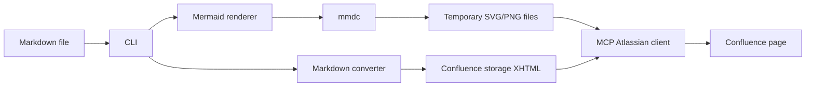
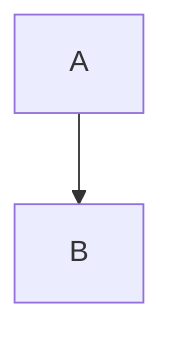

# Design

## Purpose

`confluence-markdown-publisher` is a local CLI tool for publishing Markdown documents to Confluence storage format.

The main design goal is to make Mermaid diagrams publishable without manual Confluence actions. Confluence receives a rendered diagram image as a page attachment, while the original Mermaid source remains available under a collapsed "Mermaid source" block.

This keeps Markdown as the source of truth and avoids depending on manual Gliffy rendering or unsupported Confluence-side Mermaid rendering.

## Goals

- Convert Markdown into Confluence storage XHTML.
- Publish documentation project folders through public subcommands.
- Use a project manifest as the source of truth for Confluence page IDs.
- Discover Markdown files recursively from a project folder with include and exclude rules.
- Validate documentation hierarchy with `index.md` as the logical page for a directory.
- Print a project publish plan before rendering or publishing.
- Render Mermaid fenced blocks locally with `mmdc`.
- Upload rendered diagrams as Confluence page attachments.
- Insert Confluence image macros that reference those attachments.
- Keep each Mermaid source block in the page under a collapsed expand macro.
- Support dry-run previews before live publishing.
- Use existing MCP/CLI tooling for Confluence writes instead of a custom Confluence REST client.
- Keep credentials outside the project and read them only from environment variables.

## Non-Goals

- This tool is not a full Markdown-to-Confluence implementation.
- It does not try to render Mermaid inside Confluence.
- By default it does not create Confluence pages. Missing-page creation is available only through an explicit project-mode flag.
- It does not delete, move, or reorder Confluence page tree relationships.
- It does not provide a hosted service, daemon, or scheduler.
- It does not store rendered diagrams permanently in the repository.
- It does not currently make publishing atomic. Attachments are uploaded before the page body is updated.

## High-Level Architecture



The CLI orchestrates the whole publish operation. Most modules are intentionally small and have one primary responsibility:

| Module | Responsibility |
|---|---|
| `cli.py` | Parse public subcommands, coordinate rendering, conversion, preview, confirmation, and publish. |
| `manifest.py` | Load and validate project manifests. |
| `project.py` | Discover Markdown files under a project root with include and exclude patterns. |
| `planner.py` | Build validated project publish plans from discovered files and manifest pages. |
| `batch.py` | Format validated project publish plans. |
| `sync.py` | Reconcile manifest state with readable Confluence pages, recreate missing pages when policy allows it, and skip unchanged content by hash. |
| `bidirectional.py` | Compare local Markdown with remote Confluence storage through canonical Markdown hashes and safely pull remote-only changes. |
| `converter.py` | Find fenced code blocks, collect Mermaid metadata, convert Markdown to storage-ready HTML fragments. |
| `storage_to_markdown.py` | Convert the supported Confluence storage subset back to canonical Markdown for sync checks. |
| `renderer.py` | Call `mmdc` and validate that a rendered output file was produced. |
| `storage.py` | Build Confluence storage macros for code, images, expand blocks, fallback panels, and TOC. |
| `mcp_atlassian.py` | Start `mcp-atlassian` through `uvx` and call the Confluence MCP tools. |
| `models.py` | Define immutable data objects and stable diagram attachment names. |

## Public CLI

The public commands are:

- `clone`: bootstrap a local Markdown project from an existing Confluence page tree.
- `plan`: validate the project manifest and print the publish plan without rendering or connecting to Confluence.
- `status`: compare local Markdown, manifest baselines, and current Confluence storage.
- `pull`: copy safe remote-only Confluence changes back into local Markdown.
- `push`: render local Markdown and update Confluence.

Single-page publishing is no longer public CLI behavior. Page preparation remains an internal operation used by sync-backed project `push`.

## Page Preparation Flow

1. The project pipeline selects a planned Markdown page and target Confluence page ID.
2. The CLI reads the Markdown file as UTF-8 text.
3. `converter.collect_mermaid_blocks()` scans triple-backtick fenced code blocks with language `mermaid`.
4. Each Mermaid block becomes a `DiagramBlock` with:
   - ordinal position within the page
   - page slug derived from the Markdown filename
   - original Mermaid source
   - output format, currently `svg` or `png`
   - optional display width from a first-line Confluence directive
5. The CLI creates a temporary directory for render inputs and outputs.
6. `MermaidRenderer` writes each Mermaid source to a temporary `.mmd` file and calls `mmdc`.
7. Rendered files are named deterministically with page slug, ordinal, and an 8-character source hash.
8. `storage.diagram_fragment()` creates a Confluence image macro plus a collapsed expand macro containing the Mermaid source.
9. `converter.convert_markdown_to_storage()` converts the rest of the Markdown with the Python `markdown` library and replaces temporary placeholders with Confluence storage fragments.
10. The CLI prints a preview with page ID, title, source path, output format, fallback mode, attachment names, and the beginning of the generated storage.
11. In `--dry-run` mode, the process stops before any Confluence connection.
12. In live mode, the CLI asks for confirmation unless `--yes` is passed.
13. The MCP client uploads diagram attachments first.
14. The MCP client updates the Confluence page with `content_format: "storage"`.

## Project Publish Flow

Project mode starts from a documentation folder instead of a single Markdown file:

```bash
publish-confluence plan docs
```

The default manifest path is `<project>/.confluence-publish.yml`. The manifest stores all Confluence page IDs and optional titles or URLs:

```yaml
space: "~6393203da593cb822e995262"

include:
  - "**/*.md"

exclude:
  - "**/drafts/**"

defaults:
  version_comment: "Sync documentation from Markdown"
  output_format: "svg"
  diagram_width: 1000
  allow_diagram_fallback: false

pages:
  index.md:
    page_id: "111111"
    title: "Project Documentation"
    url: "https://criteo.atlassian.net/wiki/pages/111111/Project+Documentation"
```

Project mode flow:

1. The CLI loads the manifest.
2. `project.discover_markdown_files()` discovers Markdown files under the project root.
3. Include and exclude patterns are validated so they cannot use parent traversal or absolute paths.
4. Symlinked files and files under symlinked directories are skipped to avoid publishing outside-root content.
5. `planner.build_publish_plan()` checks that every discovered Markdown file exists in `pages`.
6. Manifest entries that point to missing local files are rejected.
7. `index.md` is treated as the logical page for its directory unless the manifest opts into an explicit local root with `root.source_path`.
8. Nested documents require a nearest ancestor `index.md` entry in the manifest unless they use an explicit `pages.<path>.parent`.
9. Titles come from manifest `title`, then the first Markdown H1, then the file stem.
10. Optional `url` values are validated by exact page ID path segment.
11. The CLI prints the publish plan before rendering or connecting to Confluence.
12. `plan` exits after validation and plan output.
13. `push --dry-run` renders and converts pages, prints storage previews, and never connects to Confluence.
14. Live project publishing asks for confirmation unless `--yes` is passed.
15. `push` publishes each planned page through the sync-backed project pipeline.

Project mode does not create Confluence pages by default. Missing `page_id` mappings are planning errors that stop the run before rendering or MCP startup.

When `--create-missing-pages` is enabled on `plan` or `push`, the manifest must provide a parent for missing pages. Legacy manifests provide an existing Confluence root page through `root.page_id`, `root.url`, `root_page_id`, or `root_url`; missing top-level pages are created under that page. Explicit hierarchy manifests set `root.source_path` to the local documentation root and `root.parent_page_id` to the existing Confluence parent; the local root is created under `root.parent_page_id`, and top-level pages without `pages.<path>.parent` are created under `root.source_path`. The planner allows manifest pages without `page_id`, validates explicit parents, detects parent cycles, orders parents before children, and preserves legacy `index.md` hierarchy for manifests without `root.source_path`. Live publishing creates missing pages through `confluence_create_page`, writes the returned `page_id` values back to `.confluence-publish.yml`, then publishes page content through the existing update pipeline. `plan` reports the pages that would be created without connecting to MCP, and `push --dry-run` previews storage without creating pages.

## Sync Recovery Flow

Sync mode extends project mode for standalone documentation projects where the manifest is allowed to track Confluence identity and publish state:

```yaml
space: "~6393203da593cb822e995262"

sync:
  enabled: true
  recreate_missing_root: true
  recreate_stale_pages: true

root:
  source_path: "00-overview.md"
  parent_page_id: "2163738446"
  page_id: "5155097071"
  url: "https://criteo.atlassian.net/wiki/spaces/~6393203da593cb822e995262/pages/5155097071/Project+Overview"

pages:
  00-overview.md:
    page_id: "5155097071"
    title: "Project Overview"
    content_hash: "sha256:..."
    last_synced_at: "2026-04-28T12:00:00Z"
```

The effective sync policy is the union of manifest settings and CLI flags:

- `sync.enabled: true` routes project publishing through `sync_project()`.
- `sync.recreate_missing_root: true` or `--recreate-missing-root` allows root recreation.
- `sync.recreate_stale_pages: true` or `--recreate-stale-pages` allows non-root stale page recreation.
- The recreate flags can be passed to `plan` or `push` for a one-run recovery policy.

Live sync flow:

1. The CLI builds and prints the same project publish plan as normal project mode.
2. If the root page has a `page_id`, `sync_project()` verifies it is readable with `confluence_get_page`.
3. If the root is not readable, root recreation requires `recreate_missing_root` and `root.parent_page_id`.
4. The parent page is validated before any root recreation side effect.
5. Existing non-root page IDs are checked for readability.
6. Unreadable non-root pages require `recreate_stale_pages`.
7. Recreating a stale page also recreates its descendants so the local tree remains attached to the new parent chain.
8. Pages without `page_id` are created under their planned parent when the root is readable.
9. Before any create operation, the tool checks local duplicate titles and Confluence title collisions in the target space.
10. Each successful create immediately writes the new `page_id` and URL to `.confluence-publish.yml`.
11. The page content is rendered to storage format and hashed.
12. Existing pages whose stored manifest hash matches the new hash are skipped.
13. Pages that changed or were just created are updated through the regular attachment-upload and storage-update pipeline.
14. After a successful page update, the manifest receives the page `content_hash` and `last_synced_at` timestamp.

The content hash includes the page title, generated storage XHTML, output format, diagram width, fallback policy, and a hash schema version. This is intentionally local-state based; the tool does not read remote page bodies to reconstruct hashes.

After a successful sync update, the manifest also receives a `canonical_hash` for the local Markdown. This hash is separate from `content_hash`: `content_hash` protects the generated storage update path, while `canonical_hash` is the baseline used by bidirectional checks and pull conflict detection.

`plan` stops after plan validation and never renders, connects to MCP, creates pages, or writes the manifest. `push --dry-run` renders local storage previews through the sync path without connecting to MCP or writing the manifest.

Sync recovery does not delete orphaned Confluence pages, empty trash, move existing pages, or repair remote tree relationships for readable pages. Those operations stay manual because they are destructive or ambiguous in shared Confluence spaces.

## Bidirectional Sync Target

Bidirectional sync is implemented conservatively as a check/pull layer on top of project manifests.

```bash
publish-confluence status docs
publish-confluence pull docs --dry-run
publish-confluence pull docs --yes
```

`status` reads the remote storage body for each mapped page, converts the supported storage subset back to canonical Markdown, hashes it, and compares it with the local Markdown hash and the stored `canonical_hash` baseline. It does not write local files or Confluence pages.

`pull` uses the same comparison but writes local Markdown only for remote-only changes. A page is safe to pull when:

- the remote storage converts without unsupported macros;
- the page has a stored `canonical_hash`;
- the local Markdown still matches that baseline;
- the remote canonical hash differs from the baseline.

Pull mode refuses unknown divergence, local-only changes, local/remote conflicts, and unsupported remote storage. This avoids silently overwriting local edits or losing unsupported Confluence content.

Supported reverse-conversion constructs are intentionally limited to the publisher-owned subset:

- headings, paragraphs, lists, simple tables, bold, italic, inline code, and links;
- Confluence code macros;
- Mermaid image macros followed by collapsed "Mermaid source" code blocks;
- warning, note, info, and tip panels;
- Confluence task lists;
- generated TOC macros, which are ignored during reverse conversion.

Unsupported macros are reported in the check result instead of being converted to approximate Markdown.

## Mermaid Handling

Mermaid diagrams are rendered locally because Confluence does not provide a reliable automatic Mermaid rendering path for this workflow.

For each Mermaid block, the rendered file name is stable:

```text
diagram-<page-slug>-<ordinal>-<hash8>.<format>
```

The hash is based on normalized Mermaid source text, so the attachment name changes when the diagram source changes. This helps avoid stale browser or Confluence attachment caching while keeping names predictable.

The default image width is controlled by `--diagram-width` and defaults to `1000`.

A document can override one diagram width with a first-line directive inside the Mermaid block:

````markdown

````

The directive remains in the Mermaid source stored under the collapsed Confluence block. `mmdc` accepts Mermaid comments, so the same source can be rendered without stripping the directive.

## Markdown Conversion

The converter uses a two-step approach:

1. Replace fenced code blocks with unique placeholders before Markdown-to-HTML conversion.
2. Convert the remaining Markdown to HTML with `markdown` extensions for tables and sane lists.
3. Replace placeholder paragraphs with Confluence storage fragments.

This avoids the Markdown library escaping generated Confluence storage macros as plain text.

Current conversion behavior:

- Mermaid fences become rendered image macros plus collapsed source blocks.
- Non-Mermaid fences become Confluence `code` macros.
- Markdown tables become HTML tables through the Markdown library.
- Blockquotes become Confluence panel macros:
  - `warning` or `important` prefix -> warning panel
  - `tip` prefix -> tip panel
  - `note` prefix -> info panel
  - otherwise -> note panel
- Documents with three or more Markdown headings receive a Confluence TOC macro at the top.

The fenced block scanner currently targets triple-backtick fences. Tilde fences and indented code blocks are outside the current scope.

## Confluence Integration

The tool intentionally delegates Confluence writes to `mcp-atlassian` rather than implementing its own REST client.

`mcp_atlassian.py` starts the server with:

```text
uvx --from mcp-atlassian>=0.17.0 mcp-atlassian --enabled-tools ...
```

The enabled tool set is limited to Confluence page and attachment operations:

- `confluence_search`
- `confluence_get_page`
- `confluence_get_attachments`
- `confluence_create_page`
- `confluence_upload_attachment`
- `confluence_update_page`

Runtime publishing uses:

- `confluence_get_page` when `--title` is omitted in live mode
- `confluence_get_page` and `confluence_search` for sync preflight validation
- `confluence_get_page` with content included for bidirectional sync checks and pull
- `confluence_create_page` for explicit missing-page creation and sync recovery
- `confluence_upload_attachment` for rendered diagrams
- `confluence_update_page` for the final storage-format page body

Required environment variables:

```bash
CONFLUENCE_URL
CONFLUENCE_USERNAME
CONFLUENCE_API_TOKEN
```

The tool validates that these variables exist before starting the MCP server. It does not read credentials from files and does not print credential values.

## Error Handling

The default behavior is fail-fast:

- Missing `mmdc` stops publishing before conversion.
- A non-zero `mmdc` exit stops publishing unless fallback mode is enabled.
- Missing rendered output or an empty output file stops publishing.
- Invalid Mermaid width directives stop conversion.
- Invalid project manifests and unsafe include or exclude patterns stop project publishing before side effects.
- Missing project `page_id` mappings stop normal project publishing before rendering or MCP startup.
- In explicit create mode, missing `page_id` mappings are created under the configured root page and persisted to the manifest before content updates.
- In sync mode, unreadable root and stale page IDs fail before creation unless the matching recreation policy is enabled.
- Sync title collisions are checked before page creation because Confluence titles are unique within a space.
- Sync writes created page identities immediately after each successful create, and writes content hashes only after successful content updates.
- Missing Confluence environment variables stop live publishing before MCP startup.
- MCP tool errors are converted into Python exceptions with bounded error messages.

Fallback mode is explicit:

```bash
publish-confluence push docs --allow-diagram-fallback ...
```

When fallback mode is enabled and a diagram fails to render, the page receives a visible Confluence info panel with the Mermaid source instead of an image attachment.

## Safety Model

The tool is designed for local, operator-driven publishing.

Safety controls:

- `push --dry-run` performs rendering and conversion without connecting to Confluence.
- `plan` validates a project and prints the publish plan without rendering or connecting to Confluence.
- Live publishing requires an interactive `yes` confirmation unless `--yes` is passed.
- Attachment names are listed in the preview before publishing.
- The first part of generated storage is printed before publishing.
- Normal project mode fails before side effects when discovered Markdown files are missing manifest `page_id` mappings.
- Create mode has an explicit side effect boundary: no page creation during `plan` or `push --dry-run`; live publishing asks for confirmation unless `--yes` is passed.
- Sync mode keeps the same side effect boundary and also skips existing pages when the stored content hash still matches rendered local content.
- Project discovery rejects unsafe include and exclude patterns and skips symlinked Markdown paths.
- Confluence credentials stay in environment variables.
- Rendered diagrams are written only to a temporary directory and removed when the process exits.

Known safety limitation:

- Publishing is not transactional. If attachments upload successfully but the page update fails, those attachments may remain on the Confluence page. The stable attachment naming scheme limits confusion, but cleanup is currently a manual or future-tooling concern.

## Testing Strategy

Tests are unit-focused and avoid live Confluence writes.

Coverage areas:

- CLI argument parsing and orchestration.
- Mermaid collection and width directive parsing.
- Markdown-to-storage conversion.
- Confluence storage macro generation and escaping.
- Mermaid renderer subprocess behavior.
- MCP client command construction, response parsing, and error handling.
- Attachment naming stability.
- Project manifest loading and validation.
- Markdown project discovery with include, exclude, and safety boundaries.
- Publish-plan construction and project-mode CLI orchestration.
- Batch publishing behavior in dry-run and live modes.
- Sync recovery behavior for missing roots, stale pages, missing page IDs, title preflight, manifest writes, and unchanged-page skipping.

The standard verification command is:

```bash
uv run pytest tests/confluence_publisher -v
```

Live Confluence publishing is treated as an integration check because it depends on user credentials, network access, current Confluence permissions, and the external MCP server.

## Operational Usage

Project plan preview:

```bash
uv run publish-confluence plan docs
```

Project publish:

```bash
uv run publish-confluence push docs --comment "Sync guide updates" --yes
```

Project sync with manifest defaults:

```bash
uv run publish-confluence push docs --yes
```

One-time sync recovery override:

```bash
uv run publish-confluence plan docs --recreate-missing-root --recreate-stale-pages
uv run publish-confluence push docs --recreate-missing-root --recreate-stale-pages --yes
```

When the CLI is used from another repository:

```bash
uv run --project ~/Documents/confluence-markdown-publisher publish-confluence push docs --dry-run
```

If `mmdc` is installed outside the active `PATH`, pass it explicitly:

```bash
uv run publish-confluence push docs --mmdc-bin /path/to/mmdc --dry-run
```

## Extension Points

The current boundaries leave several incremental extension points:

- Generating a manifest skeleton from a documentation folder.
- Filling missing manifest URLs from Confluence page IDs.
- Checking local Markdown links between project documents.
- Optional cleanup or replacement policy for old diagram attachments.
- Support for more Markdown constructs if needed.
- Additional renderers if diagrams other than Mermaid become necessary.
- A second backend that uses Confluence REST directly, while keeping the CLI and converter unchanged.

These are intentionally outside the current project-mode scope because the operational need is still local, operator-driven publishing to existing Confluence pages.
