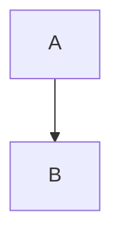

# confluence-markdown-publisher

Publish Markdown documents to Confluence storage format with rendered Mermaid diagrams.

The publisher renders Mermaid blocks with `mmdc`, uploads the rendered diagram as a Confluence attachment, inserts the image into the page, and keeps the Mermaid source under a collapsed "Mermaid source" block.

## Requirements

- Python 3.11+
- uv
- Mermaid CLI available as `mmdc`
- Confluence credentials in environment variables:

```bash
CONFLUENCE_URL=https://criteo.atlassian.net/wiki
CONFLUENCE_USERNAME=<email>
CONFLUENCE_API_TOKEN=<token>
```

Install Mermaid CLI if it is not already available:

```bash
npm install -g @mermaid-js/mermaid-cli
```

## Setup

```bash
uv sync
```

## Development

Run the full test suite:

```bash
uv run pytest tests/confluence_publisher -v
```

Measure local test coverage:

```bash
uv run pytest tests/confluence_publisher --cov=confluence_publisher --cov-report=term-missing
```

Coverage is informational and not CI-enforced. The current observed baseline is `91%`; the project target is `90%` total coverage.

## Usage

Preview conversion without publishing:

```bash
uv run publish-confluence \
  --source /path/to/document.md \
  --page-id 5151854234 \
  --title "Test" \
  --dry-run
```

Publish without an interactive prompt:

```bash
uv run publish-confluence \
  --source /path/to/document.md \
  --page-id 5151854234 \
  --title "Test" \
  --yes
```

Use a custom Mermaid CLI binary:

```bash
uv run publish-confluence \
  --source /path/to/document.md \
  --page-id 5151854234 \
  --mmdc-bin /path/to/mmdc \
  --yes
```

## Project Mode

Publish a documentation folder with a manifest:

```bash
uv run publish-confluence \
  --project docs \
  --plan-only
```

The default manifest is `docs/.confluence-publish.yml`:

```yaml
space: "~6393203da593cb822e995262"

include:
  - "**/*.md"

exclude:
  - "**/drafts/**"

defaults:
  version_comment: "Sync documentation from Markdown"

pages:
  index.md:
    page_id: "111111"
    title: "Project Documentation"
    url: "https://criteo.atlassian.net/wiki/pages/111111/Project+Documentation"
```

Project mode does not create Confluence pages by default. Every discovered Markdown file must have a `page_id` in the manifest unless `--create-missing-pages` is used.

For documentation authoring rules, use [docs/documentation-style.md](docs/documentation-style.md). For delegated preparation work, use [docs/documentation-agent-prompt.md](docs/documentation-agent-prompt.md).

To create missing pages under an existing Confluence root page, add `root` metadata and use `--create-missing-pages`:

```yaml
space: "~6393203da593cb822e995262"

root:
  url: "https://criteo.atlassian.net/wiki/spaces/~6393203da593cb822e995262/pages/999999/Documentation"

include:
  - "**/*.md"

pages:
  index.md:
    title: "Project Documentation"
  guide/index.md:
    title: "Guide"
```

Flat documentation sets can also declare a local documentation root with `root.source_path`. In that mode, top-level pages without an explicit `parent` are created as children of the local root page, and the local root page is created under `root.parent_page_id`:

```yaml
space: "~6393203da593cb822e995262"

root:
  source_path: "00-overview.md"
  parent_page_id: "999999"

pages:
  00-overview.md:
    title: "Project Overview"
  01-prerequisites.md:
    title: "Prerequisites"
  02-guide.md:
    title: "Guide"
    parent: "01-prerequisites.md"
```

```bash
uv run publish-confluence \
  --project docs \
  --create-missing-pages \
  --yes
```

The tool creates pages without `page_id`, writes the new `page_id` values back to `.confluence-publish.yml`, then publishes the page content. Without `--create-missing-pages`, missing `page_id` values remain an error.

### Sync And Recovery Mode

For ongoing standalone documentation projects, the manifest can enable sync mode:

```yaml
space: "~6393203da593cb822e995262"

sync:
  enabled: true
  recreate_missing_root: true
  recreate_stale_pages: true

root:
  source_path: "00-overview.md"
  parent_page_id: "2163738446"
  page_id: "5155097071"
  url: "https://criteo.atlassian.net/wiki/spaces/~6393203da593cb822e995262/pages/5155097071/Project+Overview"

pages:
  00-overview.md:
    page_id: "5155097071"
    title: "Project Overview"
  01-guide.md:
    page_id: "5155621620"
    title: "Guide"
```

With `sync.enabled: true`, project publishing checks the manifest state before writing:

- If the root page ID is no longer readable and `recreate_missing_root` is enabled, the root is recreated under `root.parent_page_id`.
- If a non-root page ID is no longer readable and `recreate_stale_pages` is enabled, that page and its descendants are recreated.
- Pages without `page_id` are created under their planned parent when the root is readable.
- Created page IDs, URLs, content hashes, and sync timestamps are written back to `.confluence-publish.yml`.
- Pages with a matching stored content hash are skipped.

The same policies can be enabled for one run with CLI flags:

```bash
uv run publish-confluence \
  --project docs \
  --sync \
  --recreate-missing-root \
  --recreate-stale-pages \
  --yes
```

`--recreate-missing-root` and `--recreate-stale-pages` imply `--sync`. Manifest settings do not bypass confirmation; live writes still require `--yes` or an interactive `yes`.

Use `--plan-only` to inspect the effective sync settings without rendering, connecting to MCP, or writing anything. Use `--dry-run` to render local previews without connecting to MCP.

Sync mode does not delete, move, or reorder Confluence pages. Confluence page titles are unique within a space, so title collisions fail before creation and must be resolved in the manifest.

### Bidirectional Sync Checks

Project mode can compare local Markdown with the current Confluence page body:

```bash
uv run publish-confluence \
  --project docs \
  --check-sync
```

`--check-sync` reads each mapped Confluence page, converts supported Confluence storage XHTML back to canonical Markdown, and compares it with the local Markdown file. It does not render diagrams, write local files, or update Confluence. The command exits with a non-zero status when it detects unsupported remote content, unknown divergence, or a local/remote conflict.

The reverse conversion currently supports the publisher-owned subset:

- headings, paragraphs, ordered and unordered lists;
- bold, italic, inline code, and links;
- code macros;
- Mermaid image plus collapsed "Mermaid source" blocks;
- warning, note, info, and tip panels;
- Confluence task lists;
- simple tables;
- publisher-generated TOC macros.

Remote macros outside this subset are reported as unsupported instead of being converted silently.

To pull safe remote-only changes back into Markdown:

```bash
uv run publish-confluence \
  --project docs \
  --pull \
  --dry-run
```

Remove `--dry-run` and add `--yes` to update local Markdown files. Pull mode only writes pages whose local content still matches the stored `canonical_hash` baseline and whose remote content changed. It refuses to overwrite local changes, unknown divergence, or unsupported remote content.

Successful project sync updates now also store a per-page `canonical_hash` in `.confluence-publish.yml`. This hash is the baseline used by later bidirectional checks:

```yaml
pages:
  index.md:
    page_id: "111111"
    title: "Project Documentation"
    content_hash: "sha256:..."
    canonical_hash: "sha256:..."
    last_synced_at: "2026-04-28T12:00:00Z"
```

Publish with a version comment:

```bash
uv run publish-confluence \
  --project docs \
  --comment "Sync guide updates" \
  --yes
```

## Diagram Size

Set the default rendered image width for all diagrams:

```bash
uv run publish-confluence \
  --source /path/to/document.md \
  --page-id 5151854234 \
  --diagram-width 1400 \
  --yes
```

Override width per Mermaid block with a first-line directive:

````markdown

````

## Fallback Mode

By default, Mermaid render failures stop publishing. To publish the Mermaid source in Confluence instead of failing:

```bash
uv run publish-confluence \
  --source /path/to/document.md \
  --page-id 5151854234 \
  --allow-diagram-fallback \
  --yes
```

## Tests

```bash
uv run pytest tests/confluence_publisher -v
```
