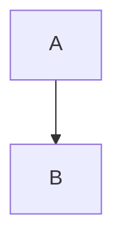

# confluence-markdown-publisher

Publish Markdown documents to Confluence storage format with rendered Mermaid diagrams.

The publisher renders Mermaid blocks with `mmdc`, uploads the rendered diagram as a Confluence attachment, inserts the image into the page, and keeps the Mermaid source under a collapsed "Mermaid source" block.

## Requirements

- Python 3.11+
- uv
- Mermaid CLI available as `mmdc`
- Confluence credentials in environment variables:

```bash
CONFLUENCE_URL=https://criteo.atlassian.net/wiki
CONFLUENCE_USERNAME=<email>
CONFLUENCE_API_TOKEN=<token>
```

Install Mermaid CLI if it is not already available:

```bash
npm install -g @mermaid-js/mermaid-cli
```

## Setup

```bash
uv sync
```

## Usage

Preview conversion without publishing:

```bash
uv run publish-confluence \
  --source /path/to/document.md \
  --page-id 5151854234 \
  --title "Test" \
  --dry-run
```

Publish without an interactive prompt:

```bash
uv run publish-confluence \
  --source /path/to/document.md \
  --page-id 5151854234 \
  --title "Test" \
  --yes
```

Use a custom Mermaid CLI binary:

```bash
uv run publish-confluence \
  --source /path/to/document.md \
  --page-id 5151854234 \
  --mmdc-bin /path/to/mmdc \
  --yes
```

## Project Mode

Publish a documentation folder with a manifest:

```bash
uv run publish-confluence \
  --project docs \
  --plan-only
```

The default manifest is `docs/.confluence-publish.yml`:

```yaml
space: "~6393203da593cb822e995262"

include:
  - "**/*.md"

exclude:
  - "**/drafts/**"

defaults:
  version_comment: "Sync documentation from Markdown"

pages:
  index.md:
    page_id: "111111"
    title: "Project Documentation"
    url: "https://criteo.atlassian.net/wiki/pages/111111/Project+Documentation"
```

Project mode never creates Confluence pages. Every discovered Markdown file must have a `page_id` in the manifest.

For documentation authoring rules, use [docs/documentation-style.md](docs/documentation-style.md). For delegated preparation work, use [docs/documentation-agent-prompt.md](docs/documentation-agent-prompt.md).

Publish with a version comment:

```bash
uv run publish-confluence \
  --project docs \
  --comment "Sync guide updates" \
  --yes
```

## Diagram Size

Set the default rendered image width for all diagrams:

```bash
uv run publish-confluence \
  --source /path/to/document.md \
  --page-id 5151854234 \
  --diagram-width 1400 \
  --yes
```

Override width per Mermaid block with a first-line directive:

````markdown

````

## Fallback Mode

By default, Mermaid render failures stop publishing. To publish the Mermaid source in Confluence instead of failing:

```bash
uv run publish-confluence \
  --source /path/to/document.md \
  --page-id 5151854234 \
  --allow-diagram-fallback \
  --yes
```

## Tests

```bash
uv run pytest tests/confluence_publisher -v
```
