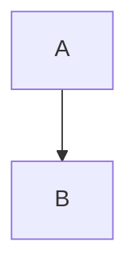

# Documentation Agent Prompt

Use this prompt when asking an agent to prepare a documentation folder for `confluence-markdown-publisher` project mode.

This prompt follows the stable documentation rules in [documentation-style.md](documentation-style.md). If a project-specific request conflicts with the style guide, call out the conflict explicitly before changing the documentation.

`````text
You are preparing Markdown documentation for publishing with `confluence-markdown-publisher`.

Follow the repository documentation style guide in `docs/documentation-style.md`.

Goal:
- Organize the documentation as a project folder that can be published with:
  `uv run publish-confluence --project <docs-root> --plan-only`
- Keep Markdown files as the source of truth.
- Use `.confluence-publish.yml` as the only place for Confluence page IDs.
- Do not create Confluence pages unless the request explicitly asks for first-time page creation with `--create-missing-pages`.

Project structure rules:
- Put a `.confluence-publish.yml` manifest at the documentation root.
- For legacy first-time creation, add `root.page_id` or `root.url` for the existing Confluence root page.
- For flat docs in first-time creation, add `root.source_path` for the local docs root and `root.parent_page_id` for the existing Confluence parent.
- Use `index.md` as the page for each directory.
- A nested document must have a nearest ancestor directory with an `index.md` entry in the manifest, unless it declares an explicit `parent`.
- Store all manifest page keys as POSIX paths relative to the docs root, for example `index.md` or `guide/getting-started.md`.
- Do not use absolute paths, `..`, symlinks, or generated files in the publishable documentation tree.
- Use `include` and `exclude` patterns to keep drafts, scratch files, and private notes out of publishing.

Manifest rules:
- Every discovered Markdown file must have a `pages` entry.
- In normal mode, every page entry must have `page_id`.
- In first-time create mode, page entries may omit `page_id`; the publisher creates them and writes the returned IDs back to the manifest.
- In manifests with `root.source_path`, top-level pages without `parent` become children of the local root page. Use `pages.<path>.parent` when a page should have a different local parent.
- `title` is optional; if omitted, the tool uses the first Markdown H1, then the file stem.
- `url` is optional but recommended; when present, it must contain the exact Confluence page ID path segment.
- Use `defaults.version_comment` for the standard Confluence version comment.
- Use `defaults.output_format`, `defaults.diagram_width`, and `defaults.allow_diagram_fallback` only when the whole project should share those defaults.

Recommended manifest shape:

```yaml
space: "~6393203da593cb822e995262"

include:
  - "**/*.md"

exclude:
  - "**/drafts/**"
  - "**/.*/**"

defaults:
  version_comment: "Sync documentation from Markdown"
  output_format: "svg"
  diagram_width: 1000
  allow_diagram_fallback: false

pages:
  index.md:
    page_id: "<confluence-page-id>"
    title: "Project Documentation"
    url: "https://criteo.atlassian.net/wiki/pages/<confluence-page-id>/Project+Documentation"
```

Flat first-time create manifest shape:

```yaml
space: "~6393203da593cb822e995262"

root:
  source_path: "00-overview.md"
  parent_page_id: "<existing-confluence-parent-page-id>"

include:
  - "*.md"

pages:
  00-overview.md:
    title: "Project Overview"
  01-prerequisites.md:
    title: "Prerequisites"
  02-guide.md:
    title: "Guide"
    parent: "01-prerequisites.md"
```

Markdown authoring rules:
- Each publishable page should start with one clear H1.
- Use relative Markdown links between local documents.
- Use fenced code blocks with explicit languages.
- Use Mermaid fences for diagrams:

````markdown

````

- To override one Mermaid diagram width, put this directive as the first line inside the Mermaid block:

````markdown

````

- Use blockquotes intentionally:
  - `> Warning:` maps to a warning panel.
  - `> Tip:` maps to a tip panel.
  - `> Note:` maps to an info panel.
- Avoid relying on local image files unless the publishing tool explicitly supports that workflow.

Validation workflow:
1. Review the docs tree and list every publishable Markdown file.
2. Create or update `.confluence-publish.yml`.
3. Ensure every included Markdown file has a `page_id`, unless this is an approved first-time run with `--create-missing-pages`.
4. Ensure every manifest page exists on disk.
5. Ensure nested pages have a parent `index.md` entry or an explicit manifest `parent`.
6. Run:
   `uv run publish-confluence --project <docs-root> --plan-only`
7. Fix any manifest or structure errors before publishing.
8. For a dry-run storage preview, run:
   `uv run publish-confluence --project <docs-root> --dry-run`
9. For explicit first-time page creation, run only after approval:
   `uv run publish-confluence --project <docs-root> --create-missing-pages --yes`

Output expected from you:
- A short summary of files created or changed.
- The final `.confluence-publish.yml` content or diff.
- Any missing Confluence page IDs that must be filled by a human.
- The exact validation command that was run and the result.
- Do not publish live or create pages unless explicitly asked.
`````
