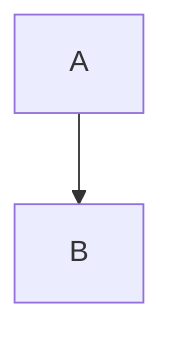

# Documentation Style Guide

Use this guide when preparing Markdown documentation for `confluence-markdown-publisher` project mode.

The reusable task prompt in [documentation-agent-prompt.md](documentation-agent-prompt.md) applies these rules when a documentation folder must be organized or validated for publishing.

## Source of Truth

- Keep Markdown files as the source of truth for page content.
- Keep `.confluence-publish.yml` as the only source of truth for Confluence page IDs.
- By default, do not create Confluence pages from this tool. Add existing `page_id` values to the manifest instead.
- Use `--create-missing-pages` only when the manifest defines the intended Confluence parent. For flat docs, use `root.source_path` for the local docs root and `root.parent_page_id` for the existing Confluence parent.
- Do not add hidden state files, generated page maps, or page IDs inside Markdown front matter.
- Do not include credentials, tokens, copied secret values, or private scratch notes in publishable files.

## Project Layout

- Put `.confluence-publish.yml` at the documentation root unless the command uses `--manifest`.
- For legacy create mode, add `root.page_id` or `root.url` for the existing Confluence root page.
- For flat documentation, add `root.source_path` for the local root page and `root.parent_page_id` for the existing Confluence parent.
- Use `index.md` as the logical page for each directory.
- Every nested Markdown page must have a nearest ancestor directory with an `index.md` manifest entry, unless it declares `parent` in the manifest.
- Store publishable files under normal directories only. Do not rely on symlinks, generated folders, absolute paths, or parent traversal.
- Keep drafts, private notes, scratch files, and generated output outside the publishable tree or exclude them explicitly.

Preferred layout:

```text
docs/
  .confluence-publish.yml
  index.md
  guide/
    index.md
    getting-started.md
  reference/
    index.md
    configuration.md
```

## Manifest Style

- Use POSIX relative paths for all `pages` keys, for example `index.md` or `guide/getting-started.md`.
- Add a `pages` entry for every included Markdown file.
- Treat `page_id` as required in normal mode.
- In create mode, pages without `page_id` are created under the root page, the nearest parent `index.md`, or the explicit `parent` source path, then the returned `page_id` values are written back to the manifest.
- Add `url` when known. It must contain the exact Confluence page ID path segment.
- Use `title` only when the Confluence title should differ from the first Markdown H1 or when the page needs an explicit stable title.
- Put shared behavior in `defaults`, especially `version_comment`, `output_format`, `diagram_width`, and `allow_diagram_fallback`.
- Keep include/exclude patterns narrow enough that `--plan-only` output is predictable.

Recommended manifest baseline:

```yaml
space: "~6393203da593cb822e995262"

include:
  - "**/*.md"

exclude:
  - "**/drafts/**"
  - "**/.*/**"

defaults:
  version_comment: "Sync documentation from Markdown"
  output_format: "svg"
  diagram_width: 1000
  allow_diagram_fallback: false

pages:
  index.md:
    page_id: "<confluence-page-id>"
    title: "Project Documentation"
    url: "https://criteo.atlassian.net/wiki/pages/<confluence-page-id>/Project+Documentation"
```

Create-mode manifest baseline:

```yaml
space: "~6393203da593cb822e995262"

root:
  url: "https://criteo.atlassian.net/wiki/spaces/~6393203da593cb822e995262/pages/<root-page-id>/Documentation"

include:
  - "**/*.md"

exclude:
  - "**/drafts/**"
  - "**/.*/**"

pages:
  index.md:
    title: "Project Documentation"
  guide/index.md:
    title: "Guide"
```

Flat create-mode manifest baseline:

```yaml
space: "~6393203da593cb822e995262"

root:
  source_path: "00-overview.md"
  parent_page_id: "<existing-confluence-parent-page-id>"

include:
  - "*.md"

pages:
  00-overview.md:
    title: "Project Overview"
  01-prerequisites.md:
    title: "Prerequisites"
  02-guide.md:
    title: "Guide"
    parent: "01-prerequisites.md"
```

## Markdown Style

- Start every publishable page with one clear H1.
- Keep headings hierarchical and avoid skipping levels without a reason.
- Use relative Markdown links between local documents.
- Use fenced code blocks with explicit language names.
- Keep long examples focused. The publisher wraps code blocks longer than 30 lines in an expand macro.
- Use tables for compact reference data, not for page layout.
- Prefer concise paragraphs and task-oriented headings over broad narrative sections.
- Avoid local image dependencies unless the publishing workflow for those images is explicitly supported.

## Confluence Mapping

- Documents with three or more headings get a table-of-contents macro automatically.
- Use blockquotes only when they should become Confluence panels:
  - `> Warning:` for warning panels.
  - `> Tip:` for tip panels.
  - `> Note:` for info panels.
  - Other blockquotes become note panels.
- Use Mermaid fences for diagrams:

````markdown

````

- To override one Mermaid diagram width, put this directive as the first line inside the Mermaid block:

````markdown

````

- Keep Mermaid diagrams deterministic and readable after rendering. Split large diagrams into multiple sections when needed.

## Validation Workflow

Before publishing:

1. Review the docs tree and list every publishable Markdown file.
2. Create or update `.confluence-publish.yml`.
3. Ensure every included Markdown file has a `page_id`, unless this is an approved first-time run with `--create-missing-pages`.
4. Ensure every manifest page exists on disk.
5. Ensure nested pages have a parent `index.md` entry or an explicit manifest `parent`.
6. Run:

```bash
uv run publish-confluence --project <docs-root> --plan-only
```

7. Fix every manifest, hierarchy, and missing-page error.
8. For a conversion preview without writing to Confluence, run:

```bash
uv run publish-confluence --project <docs-root> --dry-run
```

9. Do not run live publishing unless explicitly requested.

For first-time page creation, run live publishing with explicit approval:

```bash
uv run publish-confluence --project <docs-root> --create-missing-pages --yes
```

Review the updated `.confluence-publish.yml` after creation and commit the new `page_id` values with the documentation project.

## Handoff Checklist

When preparing documentation for someone else, report:

- files created or changed;
- the final `.confluence-publish.yml` content or diff;
- missing Confluence page IDs;
- the exact validation command and result;
- any files intentionally excluded from publishing.
